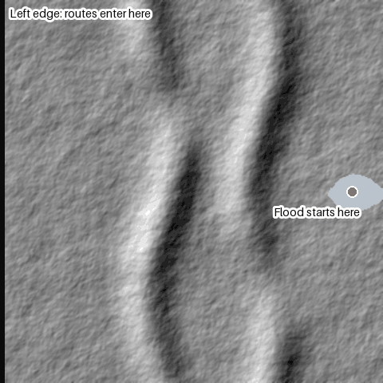
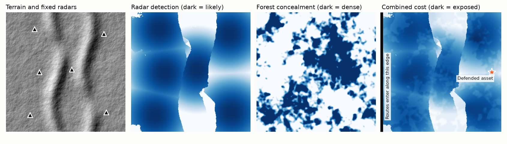
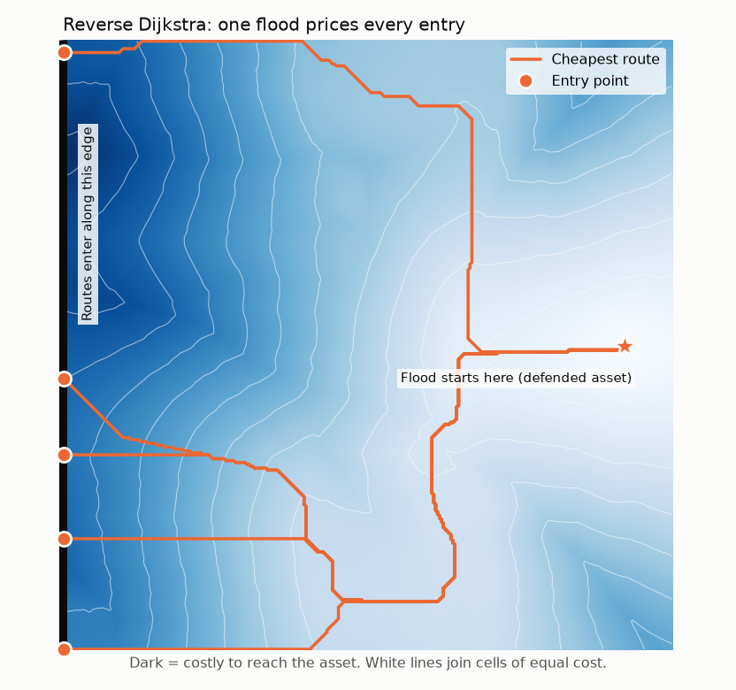
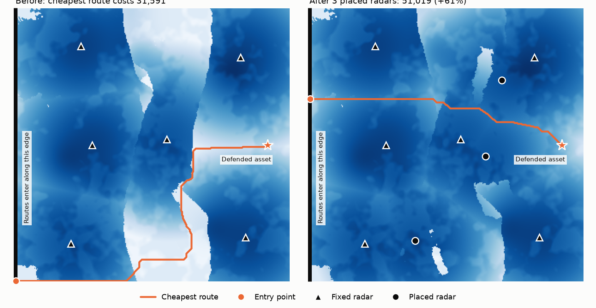

# Hologram: a public technical sample

Hologram is an interactive decision-support tool for finding gaps in low-altitude drone detection. It models the route a detection-avoiding drone would fly over real terrain, shows air-defence planners where their sensor coverage is thin, and recommends where additional sensors would close those gaps.

I developed the production algorithms and data, and they were briefed to the Latvian Ministry of Defence and NATO.

This repository is a **small, self-contained reimplementation of the core ideas on invented terrain**. The production system is private. Nothing here contains its code, data, geography, parameters or results. **To see a video of the public technical sample, see my personal website: www.yashashaw.dev**



*Reverse Dijkstra flooding outward from a defended asset. The final orange line is the cheapest route from any point on the left edge.*

**For the full annotated walkthrough**, clone the repo and open [`docs/results.html`](docs/results.html) in a browser. It explains each map, what the flood is doing, where routes start, and how to read the numbers.

## What's in this repo

| Path | What it is |
|---|---|
| [`demo.py`](demo.py) | Runs the whole pipeline, then writes and opens the results page |
| [`hologram_demo/terrain.py`](hologram_demo/terrain.py) | Seeded synthetic terrain, forest and population noise |
| [`hologram_demo/viewshed.py`](hologram_demo/viewshed.py) | Radar line of sight over terrain, with earth curvature |
| [`hologram_demo/search.py`](hologram_demo/search.py) | One compiled kernel for reverse flood, Dijkstra and A* |
| [`hologram_demo/placement.py`](hologram_demo/placement.py) | Minimax radar placement: greedy, swap refinement, exhaustive |
| [`tests/test_demo.py`](tests/test_demo.py) | Correctness tests against an independent solver |
| [`docs/`](docs/) | Generated figures, animation, metrics and results page |

## The problem

Ordinary routing asks for the fastest path. Here the question is reversed: **given a defender's sensors, what route would be hardest to detect, and where should the defender add a sensor to make even that route costly?** Detection is the thing being minimised, so a long detour through a radar shadow can beat a short exposed line.

That gives a two-level optimisation problem:

```
maximise over sensor sets S:    minimise over routes p:    exposure(p | S)
```

## How the demo works

**1. Build the cost surface.** Elevation, forest and population noise are combined with a radar model. Each radar's coverage is ray-traced over terrain with earth curvature, then graded so detection fades with range.



**2. Flood from the target.** A reverse Dijkstra search spreads outward from the defended asset. A single solve gives every border cell its cheapest route, so the map doesn't need one search per entry point. Edge costs are symmetric, which makes the reverse cost exactly what a route flying inward would pay.



**3. Search for the worst case.** When only the single cheapest route matters, A* stops early. Its heuristic is the chessboard distance to the nearest entry, scaled by the cheapest cell on the surface. That bound holds wherever the entries are.

**4. Solve the minimax.** Each candidate sensor set is scored by re-solving the adversary's best response. The demo compares greedy selection, greedy plus swap refinement, and exhaustive search as ground truth.



## Results on this scene

Measured on one 320 × 320 grid (102,400 cells at 100 m, seed 7, single-threaded). Full output, including timings for the latest run, is in [`docs/metrics.json`](docs/metrics.json).

| Search | What it answers | Cells expanded |
|---|---|---:|
| Full reverse flood | Cheapest route from every cell | 102,400 |
| Dijkstra with early exit | Cheapest entry only | 86,631 |
| A* with early exit | Cheapest entry only | 85,662 |

Choosing 3 sites from 16 candidates, against 6 fixed radars. The cost of the cheapest route starts at 31,591.

| Strategy | Cheapest-route cost after placement | Gap to optimum | Searches |
|---|---:|---:|---:|
| Greedy | 50,789 | 0.45% | 45 |
| Greedy + swap refinement | 51,019 | 0% on this scene | 95 |
| Exhaustive | 51,019 | n/a | 560 three-site sets |

Two things worth noticing:

- **A* barely helps here.** The heuristic has to assume every remaining cell is as cheap as the cheapest cell on the map, and radar raises typical costs far above that. On this surface, the reverse flood is the better tool: it costs about the same and answers every entry point.
- **Greedy is close but not optimal.** Sensors interact, because one site's value depends on where the route goes once another site is placed. Swap refinement closes the gap on this scene, but it is a local search and carries no general guarantee.

## What the production system adds

This sample leaves out most of the engineering that makes Hologram usable at full scale. At a high level, the private system has:

- A national-scale solve on a 20 m grid of about 314 million cells, using a compiled reverse Dijkstra that runs an exact sweep in about 4 minutes.
- A two-tier design for interactive use: a 160 m preview that re-solves in under a second while someone drags a radar marker, with the exact solve on demand.
- A multi-layer cost surface built from open geospatial data, with an out-of-core pipeline for rasters too large to fit in memory.
- A FastAPI backend, a MapLibre 3D operator console, and a separate partner API that only returns explicitly whitelisted fields.

Its data, tuned parameters, sensor assumptions, findings and fast optimisation methods are deliberately not published.

## Run it

```bash
python -m venv .venv && source .venv/bin/activate   # Windows: .venv\Scripts\activate
pip install -r requirements.txt
python demo.py      # regenerates docs/ and opens a results page (under a minute)
python -m pytest    # checks against an independent plain-Python solver
```

## Tests

The tests compare the compiled search against an independent plain-Python Dijkstra, confirm A* stays optimal when goals are scattered through the grid interior, verify that a traced path sums to its reported cost, and check the viewshed against flat ground, a wall and earth curvature.

## Limits

The terrain, weights and radar model are invented to make the algorithms visible. The numbers say nothing about any real location or sensor. Because the map ends where the data ends, a route can run along the scene edge, which real boundaries wouldn't allow.

## Licence

Copyright © 2026 Yasha Shaw. All rights reserved. This code is published for review only, and no licence to reuse it is granted.
